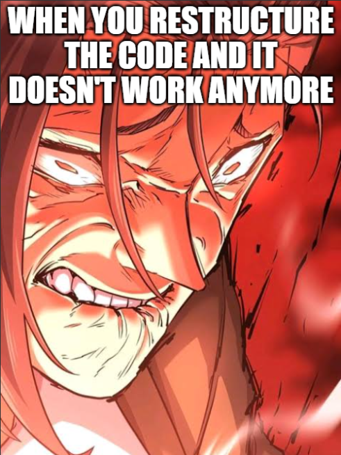

 

<h2 align="center">About Me</h2>

I'm a developer interested in building practical software, creating engaging web experiences, and exploring game development.
  
I enjoy learning new technologies, solving problems, and applying what I learn through hands-on projects. My goal is to continuously improve my skills and create meaningful, well-crafted work.

<h2 align="center">Tech Stack</h2>

<picture>
  <source media="(prefers-color-scheme: dark)" srcset="./assets/contributions.dark.svg" />
  
</picture>

 

